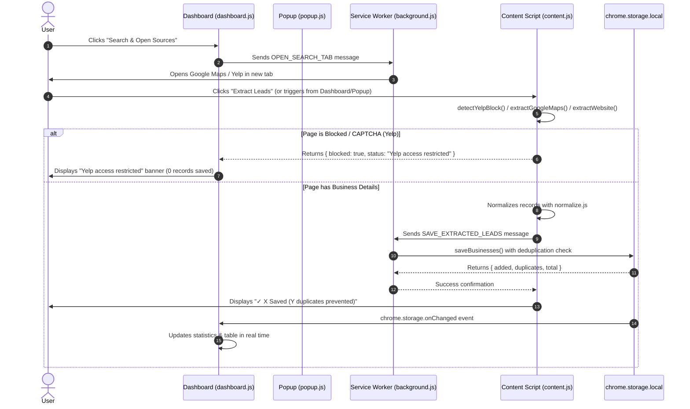

# Pastry Lead Scraper – Comprehensive Project Documentation

> **Reviewer**: Technical Hiring Manager / Engineering Reviewer  
> **Project**: Pastry Marketing – Business Lead Scraper Chrome Extension (Take-Home Assignment)  
> **Target Audience**: Home repair & service business lead generation (Plumbers, Electricians, HVAC Contractors, Roofers, Landscapers)  
> **Environment**: Google Chrome (Manifest V3) – Standalone / Load Unpacked  

---

## 1. Project Overview & Objectives

### 1.1 Objective
**Pastry Lead Scraper** is a client-side Chrome Extension designed for Pastry Marketing. Its objective is to collect, normalize, deduplicate, persist, and export business contact information from three primary sources:
1. **Google Maps** (Place profiles and search result feeds)
2. **Yelp** (Business detail profiles and local search listings)
3. **Individual Business Websites** (Schema.org JSON-LD structured data, Open Graph tags, and DOM contact elements)

### 1.2 Core Constraints
- **No Remote Backend**: Operates 100% locally within the user's browser runtime.
- **No Paid API Keys**: No Google Places API or Yelp Fusion API keys were provided or required for this MVP; all extraction is client-side and user-initiated.
- **No Remote JavaScript / CDNs**: Conforms strictly to Chrome Extension Manifest V3 Content Security Policy (CSP). Third-party dependencies (SheetJS) are bundled locally.
- **Local Persistence Only**: All collected records and operational statistics are persisted across browser sessions using `chrome.storage.local`.
- **Honest Provenance & Limitations**: The extension does not fabricate data, invent artificial mock results, or pretend a source was scraped when it was blocked by anti-bot controls.

---

## 2. Features & Functionality Implemented

### 2.1 Extension Popup (`popup.html`, `popup.js`, `popup.css`)
- **Active Tab Inspection**: Queries the active tab URL and determines whether the active site is Google Maps, Yelp, a general business website, or an unsupported browser page (`chrome://`).
- **Quick Extraction Trigger**: Dispatches extraction directly from the toolbar menu without opening the full dashboard.
- **Live License Badge**: Displays whether the extension is active or requires license key activation.
- **Metric Badges**: Real-time counter of total leads saved and duplicates prevented.
- **Dashboard Launcher**: 1-click button to launch the full-tab CRM dashboard (`dashboard.html`).

### 2.2 CRM Lead Dashboard (`dashboard.html`, `dashboard.js`, `dashboard.css`)
- **Linear/Stripe-Inspired SaaS Aesthetic**: Clean white/slate background, dark navy typography, indigo accents (`#4F46E5`), subtle borders, responsive data table, and modal confirmation dialogs.
- **Search Configuration**:
  - Keyword/trade input with 5 quick suggestion chips (`Plumber`, `Electrician`, `HVAC Contractor`, `Roofer`, `Landscaping`).
  - Target location input with 4 metro chips (`Houston, TX`, `Dallas, TX`, `Austin, TX`, `Phoenix, AZ`).
  - Source multi-select checkboxes (Google Maps, Yelp, Business Websites).
  - Multi-tab query launcher generating valid search URLs.
  - Step-by-step extraction workflow instruction banner.
- **Direct Active Tab Extractor**: Toolbar button (`⚡ Extract from Active Tab`) to pull data from the current browser tab into the dashboard.
- **Access-Restricted Status Banner**: Prominent warning banner (`#source-status-banner`) titled **"Yelp access restricted"** displayed when Yelp serves an anti-bot or CAPTCHA challenge.
- **Real-Time Statistics (5 Cards)**:
  1. *Total Businesses* (all locally stored records)
  2. *Yelp Leads* (with dynamic restricted status pill if blocked)
  3. *Google Maps Leads*
  4. *Website Leads*
  5. *Duplicates Prevented* (counter of duplicate encounters avoided)
- **Leads Table**:
  - Columns: Checkbox, Business Name, Phone Number, Category / Service, Business Link (external link), Address / Area, Website (clean domain link), Source (color-coded badge), Date Collected, Actions (Delete button).
  - Real-time live search filter (filtering by name, phone, category, address).
  - Source filter dropdown (`All Sources`, `Google Maps`, `Yelp`, `Business Website`).
  - Sortable column headers.
  - Row selection checkboxes with master *Select All* checkbox supporting indeterminate state.
  - Individual row deletion and bulk *Delete Selected* with confirmation.
  - *Clear All Records* modal with full database reset capability.
  - Illustrated empty state with 1-click search starter.

### 2.3 Floating In-Page Action Widget (`content.js`)
- Injected on target pages as a non-intrusive floating pill (`🥐 Extract Leads`) in the lower-right corner.
- Provides immediate visual feedback (`✓ X Saved (Y dup)!` or `⚠️ Yelp access restricted`).
- Includes a dismiss (`×`) control.

### 2.4 Data Normalization & Deduplication (`utils/normalize.js`)
- Strips punctuation, parentheses, spaces, hyphens, and extension codes from phone numbers.
- Converts North American phone numbers to canonical E.164-style strings (`+1XXXXXXXXXX`).
- Cleans corporate suffixes (`LLC`, `Inc`, `Corp`, `Co`, `Ltd`, `Services`) for name matching.
- Normalizes street suffixes (`Street` -> `st`, `Avenue` -> `ave`) and US state names (`Texas` -> `tx`).
- Two-tier duplicate matching:
  1. Strict normalized phone match if both records have phone numbers.
  2. Normalized name match + address token overlap (>= 60%) if phone is missing.
- Provenance preservation: Merges new source tags into the existing record (`sources: ["google_maps", "yelp"]`) and fills in previously missing contact fields.
- Rejects error and CAPTCHA titles (`isValidRecord()`).

### 2.5 Data Exports & Clipboard (`utils/export.js`)
- **CSV Export**: Native RFC 4180 quotation and comma escaping with UTF-8 BOM. Downloads as `pastry-business-leads.csv`.
- **XLSX Export**: Formatted spreadsheet generated via locally bundled SheetJS (`libs/xlsx.full.min.js`). Column widths formatted, worksheet named `Business Leads`. Downloads as `pastry-business-leads.xlsx`.
- **Clipboard TSV Copy**: Copies all or selected leads as Tab-Separated Values with headers for direct paste into Google Sheets or Microsoft Excel.

### 2.6 Evaluation License Activation (`utils/license.js`)
- Modal overlay locks dashboard functionality until activated.
- Case-insensitive, trimmed validation against hardcoded demonstration keys.
- State persisted in `chrome.storage.local`.
- Settings dialog includes a *Deactivate License* button to reset and verify activation flow.

---

## 3. Prerequisites & Installation Instructions

### 3.1 Prerequisites
- Google Chrome browser (version 102 or newer recommended for full Manifest V3 compatibility).
- No Node.js runtime, build tools, or compilation steps are needed to run the extension.
- Optional: Node.js (v18+) if you wish to run the automated unit test suite (`npm test`).

### 3.2 Installation Steps (Chrome Load Unpacked)

1. **Locate or Clone the Project Directory**:
   Ensure you have the root project directory containing `manifest.json` (e.g., `c:\dev\trial_task`).
2. **Open the Extensions Management Page**:
   In Google Chrome's address bar, type:
   ```text
   chrome://extensions
   ```
   and press **Enter**.
3. **Enable Developer Mode**:
   In the top-right corner of the Extensions page, toggle the **Developer mode** switch to **ON**.
4. **Load the Unpacked Extension**:
   - In the top-left toolbar, click the **Load unpacked** button.
   - In the folder selection dialog, navigate to and select the project root folder (`c:\dev\trial_task`).
   - Click **Select Folder**.
5. **Verify Installation**:
   - You will see the **Pastry Lead Scraper** extension card appear with version `1.0.0` and the croissant logo.
   - Verify that there are **no manifest or initialization errors**.
6. **Pin to Toolbar (Recommended)**:
   Click the puzzle piece icon (Extensions menu) in the Chrome toolbar and pin **Pastry Lead Scraper** for quick access.

---

## 4. License Activation Process & Demo Keys

### 4.1 Evaluation Keys
The extension requires activation before access to the dashboard is granted. The following keys are hardcoded in [`utils/license.js`](file:///c:/dev/trial_task/utils/license.js):

| Demonstration Key | Description |
| :--- | :--- |
| `PASTRY-DEMO-2026` | Primary evaluation key for Pastry Marketing review |
| `PASTRY-TEST-001` | Secondary evaluation key |
| `PASTRY-TEST-002` | Tertiary evaluation key |

### 4.2 Activation Behavior
- Validation is **case-insensitive** and **trims leading/trailing whitespace** (e.g., `pastry-demo-2026` is accepted).
- Any invalid string (e.g., `INVALID-KEY`, blank text) is rejected with an inline error message:  
  *"Invalid license key. Please check your key or use a demo key (e.g. PASTRY-DEMO-2026)."*
- The activation screen provides clickable key chips; clicking any chip automatically fills the input.
- Upon activation, an object `{ key, status: 'active', activatedAt: ISO_DATE }` is stored in `chrome.storage.local` under the key `pastry_license`.
- The dashboard unlocks immediately, and the header pill displays `Active: <KEY>`.

### 4.3 Security & Prototype Notice
> **IMPORTANT SECURITY NOTE**: This client-side validation is designed **exclusively as an MVP demonstration** for evaluation purposes. In a commercial production environment, client-side hardcoded validation is inherently insecure. Production licensing requires asymmetric cryptographic tokens (JWTs) validated against an authenticated backend service, team seat management, hardware-bound telemetry, and periodic revocation checks.

### 4.4 How to Deactivate for Testing
1. In the Dashboard header, click the **Settings** button (gear icon).
2. Click **Deactivate License (Reset for Testing)**.
3. The license record is cleared from `chrome.storage.local`, and the activation modal re-locks the interface immediately.

---

## 5. Step-by-Step User Guide

### Step 1: Open the Dashboard
- Click the Pastry icon in your Chrome toolbar and click **Open Lead Dashboard**, or navigate directly to:
  ```text
  chrome-extension://<EXTENSION_ID>/dashboard.html
  ```
- If prompted, activate with `PASTRY-DEMO-2026`.

### Step 2: Configure & Launch Search
1. In the **Search Configuration** card:
   - **Keyword / Trade**: Enter a trade (e.g., `Plumber`, `Electrician`, `HVAC Contractor`) or click one of the quick chips.
   - **Location / Market**: Enter a location (e.g., `Houston, Texas`) or click a location chip.
   - **Sources**: Select `Google Maps`, `Yelp`, and/or `Business Websites`.
2. Click **Open Selected Sources & Extract**.
3. The extension generates query URLs:
   - Google Maps: `https://www.google.com/maps/search/Plumber+in+Houston,+Texas`
   - Yelp: `https://www.yelp.com/search?find_desc=Plumber&find_loc=Houston%2C%20Texas`
4. The requested search pages open in new tabs, and the dashboard displays an instruction guide banner.

### Step 3: Extract Leads from Active Pages
There are three ways to extract data from an opened page:
- **Method A (In-Page Floating Widget)**: On any Google Maps, Yelp, or website tab, click the floating **"🥐 Extract Leads"** pill in the lower-right corner.
- **Method B (Toolbar Popup)**: Click the extension icon in the Chrome toolbar and click **Extract Leads**.
- **Method C (Dashboard Header Button)**: Switch back to the Dashboard tab and click **⚡ Extract from Active Tab**.

### Step 4: Inspect & Manage Leads in Dashboard
1. The extracted leads are immediately displayed in the **Results Table**.
2. **Search Filter**: Type into the filter input to search instantly across business names, phone numbers, categories, and addresses.
3. **Source Filter**: Filter by `All Sources`, `Google Maps`, `Yelp`, or `Website`.
4. **Sort Columns**: Click any table header (`Business Name`, `Phone Number`, `Category`, `Address`, `Source`, `Date Collected`) to toggle ascending/descending order.
5. **Selection**: Check individual row checkboxes or click the master checkbox in the table header to select all visible rows.
6. **Deletion**:
   - Delete an individual lead by clicking the trash icon in its row.
   - Delete selected leads by clicking **Delete Selected** (requires confirmation).
   - Clear all records by clicking **Clear All** (requires confirmation).

### Step 5: Exporting Collected Data
- **Export CSV**: Click **Export CSV** to download `pastry-business-leads.csv`.
- **Export XLSX**: Click **Export XLSX** to download `pastry-business-leads.xlsx`.
- **Copy to Clipboard (TSV)**:
  - Click **Copy All** to copy all visible records as tab-separated values.
  - Click **Copy Selected** to copy only checked rows.
  - Open Google Sheets or Excel and press `Ctrl+V` (or `Cmd+V`) to paste rows directly into spreadsheet columns.

---

## 6. Technical Architecture

```text
pastry-lead-scraper/
│
├── manifest.json              # Extension manifest (MV3 specification)
├── background.js              # Service Worker message router & tab coordinator
├── content.js                 # Content script injected on target pages; floating widget
│
├── popup.html / .css / .js    # Extension toolbar popup
├── dashboard.html / .css / .js# Full-tab SaaS CRM Lead Dashboard
├── package.json               # Project manifest & npm test script
├── .gitignore                 # Standard git ignore definitions
│
├── utils/
│   ├── normalize.js           # Phone/name/address normalization & deduplication engine
│   ├── storage.js             # chrome.storage.local abstraction & metrics tracking
│   ├── license.js             # Evaluation key validation & persistence
│   ├── export.js              # CSV, SheetJS XLSX, and TSV clipboard generators
│   ├── extractWebsite.js      # Schema.org JSON-LD LocalBusiness & DOM metadata extractor
│   ├── extractGoogleMaps.js   # Google Maps profile & feed extractor
│   └── extractYelp.js         # Yelp profile extractor, block detector & API adapter
│
├── libs/
│   └── xlsx.full.min.js       # Bundled SheetJS v0.20.3 (offline, zero remote CDN)
│
├── assets/
│   └── icons/                 # Extension PNG icons (16px, 32px, 48px, 128px)
│
├── test-fixtures/             # Local offline HTML test pages
│   ├── sample-business.html   # Simulated plumber website with Schema.org JSON-LD
│   ├── sample-google-maps.html# Simulated Google Maps place details DOM fixture
│   ├── sample-yelp.html       # Simulated Yelp business profile DOM fixture
│   └── sample-yelp-blocked.html# Simulated Yelp access-denied / challenge fixture
│
├── scripts/
│   ├── test_all.js            # Automated core test suite
│   └── test_extractors.js     # DOM extractor verification against HTML fixtures
│
├── README.md                  # Concise project overview & link to documentation
├── FEATURE_STATUS.md          # Verification report for Yelp access restrictions
├── INTERVIEW_PREP.md          # Speaking guide & anticipated questions
└── DOCUMENTATION.md           # This comprehensive documentation file
```

### 6.1 Component Interaction Diagram



---

## 7. Data Flow & Normalization Engine

### 7.1 Normalized Lead Schema
Every extraction source normalizes raw DOM data into a consistent JavaScript object:

```javascript
{
  id: "pastry_l8z2k1_9x8q",                           // Generated unique identifier
  name: "Apex Plumbing & Drain Solutions",           // Business title
  phone: "+17135554321",                             // Standardized E.164 phone
  category: "Plumber",                               // Primary trade / category
  businessLink: "https://www.google.com/maps/place/..", // URL of profile
  address: "2400 Post Oak Blvd, Houston, TX 77056", // Street address & locality
  website: "https://apexplumbinghouston.com",        // Direct website
  source: "google_maps",                             // "google_maps" | "yelp" | "website"
  collectedAt: "2026-11-07T10:20:00.000Z",           // ISO timestamp
  sources: ["google_maps", "yelp"]                   // Cross-platform provenance array
}
```

### 7.2 Phone Number Normalization Algorithm (`utils/normalize.js`)
1. Strips `tel:` prefixes.
2. Strips extension notations matching `/(?:ext|x|#)\s*\d+/i`.
3. Strips all non-digit characters (`\D`).
4. North American Standard: If 10 digits are extracted (e.g., `7135551234`), prepends `+1` to yield `+17135551234`.
5. If 11 digits starting with `1` (e.g., `17135551234`), prepends `+` to yield `+17135551234`.
6. Preserves international `+` for foreign formats.

### 7.3 Deduplication Hierarchy (`areDuplicates()`)
1. **Phone Comparison**: If both records possess normalized phone numbers, compare `normPhoneA === normPhoneB`. A phone match is the most reliable indicator of identity.
2. **Name + Address Token Fallback**: If either record lacks a phone number:
   - Normalize both names by stripping corporate suffixes (`LLC`, `Inc`, `Corp`, `Co`, `Ltd`, `Services`) and whitespace.
   - If normalized names match, normalize addresses (standardizing street types and state codes).
   - If normalized addresses match, contain each other, or share >= 60% token overlap (Jaccard similarity), the records are treated as duplicates.
3. **Website Domain Fallback**: If names match and addresses are absent, compare hostname roots (e.g., `apexplumbinghouston.com`).
4. **Provenance Retention**: When a duplicate is detected:
   - The duplicate is **not** appended as a new row.
   - The existing record's `sources` array is updated to include the new source (e.g., `["google_maps", "yelp"]`).
   - Any previously missing field (e.g., website found on Yelp that was absent on Google Maps) is backfilled.
   - The `duplicatesPrevented` statistic counter is incremented.

---

## 8. Export Implementation & Clipboard Functionality

### 8.1 Native CSV Export (`utils/export.js`)
- **Standard**: RFC 4180 compliant.
- **Escaping**: If any cell contains commas, double quotes, or newlines, the entire cell is wrapped in double quotes, and interior double quotes are escaped as `""`.
- **Character Encoding**: Includes a UTF-8 Byte Order Mark (`\uFEFF`) at the beginning of the file so Microsoft Excel opens special characters and accents cleanly.
- **Trigger**: Native browser `Blob` and `URL.createObjectURL` anchor download.
- **Filename**: `pastry-business-leads.csv`.

### 8.2 XLSX Spreadsheet Export (`libs/xlsx.full.min.js`)
- **Library**: Bundled SheetJS version 0.20.3 (`libs/xlsx.full.min.js`).
- **Offline / CSP Compliant**: Hosted entirely within the extension source tree. No external scripts are downloaded.
- **Formatting**:
  - WorkSheet name: `Business Leads`.
  - Column auto-widths configured: Business Name (28), Phone (18), Category (22), Business Link (32), Address (32), Website (28), Source (14), Date (22), Lead ID (24).
- **Trigger**: `XLSX.writeFile(workbook, 'pastry-business-leads.xlsx')`.

### 8.3 Tab-Separated Values (TSV) Clipboard Copy
- **Format**: Columns delimited by tabs (`\t`), rows delimited by CRLF (`\r\n`).
- **Sanitization**: Replaces any internal tab characters or line breaks inside text fields with single spaces to keep spreadsheet rows aligned.
- **API**: Uses `navigator.clipboard.writeText` with a fallback to `document.execCommand('copy')` via a hidden `<textarea>`.
- **Target Use**: Allows users to click **Copy All** or **Copy Selected** and press `Ctrl+V` (or `Cmd+V`) directly in Google Sheets or Microsoft Excel.

---

## 9. Local Storage & Persistence Behavior

### 9.1 Storage Mechanism (`chrome.storage.local`)
All persistence is handled through `chrome.storage.local` via the `StorageAdapter` in [`utils/storage.js`](file:///c:/dev/trial_task/utils/storage.js).

| Storage Key | Data Structure | Purpose |
| :--- | :--- | :--- |
| `pastry_businesses` | `Array<BusinessRecord>` | Array of collected business lead objects. |
| `pastry_license` | `Object` | Active license information (`{ key, status, activatedAt, type }`). |
| `pastry_stats` | `Object` | Operational metrics (`{ duplicatesPrevented: number }`). |

### 9.2 Persistence Lifecycle
- Data persists across closing and reopening Google Chrome.
- Data persists across extension reload or dashboard tab refreshes.
- Changes made in content scripts or background workers are automatically synchronized to open dashboard tabs via `chrome.storage.onChanged`.
- Clearing data requires an explicit user action via **Clear All** or **Reset All Data** in the Settings dialog.

---

## 10. Chrome Extension Permissions & Justification

The extension requests the minimum necessary permissions in [`manifest.json`](file:///c:/dev/trial_task/manifest.json):

| Permission | Technical Purpose |
| :--- | :--- |
| `storage` | Required to persist collected business leads, deduplication counts, and license activation state in `chrome.storage.local`. |
| `tabs` | Required to query active browser tabs, determine active URLs, and launch search query tabs for Google Maps and Yelp. |
| `activeTab` | Grants temporary host access to the currently focused tab when the user clicks the extension action icon. |
| `scripting` | Required by the background service worker to inject content scripts programmatically into tabs that were opened prior to extension installation. |

### Host Permissions
```json
"host_permissions": [
  "*://*.google.com/maps/*",
  "*://*.google.ca/maps/*",
  "*://*.google.co.uk/maps/*",
  "*://*.yelp.com/*",
  "<all_urls>"
]
```
- Google Maps & Yelp host patterns permit content script injection on search and profile pages.
- `<all_urls>` is required because the extension supports extracting business contact metadata from arbitrary individual home service contractor websites visited by the user.

---

## 11. Detailed Feature Status Table

This table reflects the **actual code implementation and test verification status** in the codebase.

| Feature | Implementation Status | Testing Status | Detailed Explanation |
| :--- | :---: | :---: | :--- |
| **Manifest V3 Core** | **Implemented** | **Fully Tested** | Validated schema, background service worker, declarative content scripts, and PNG icon assets across 16x16, 32x32, 48x48, 128x128. |
| **License Activation Modal** | **Implemented** | **Fully Tested** | Validates against `PASTRY-DEMO-2026`, `PASTRY-TEST-001`, `PASTRY-TEST-002`. Case-insensitive, trims whitespace, locks dashboard when inactive. |
| **License Deactivation** | **Implemented** | **Fully Tested** | Settings modal includes a reset button that purges `pastry_license` from storage and re-locks the dashboard. |
| **Search URL Generation** | **Implemented** | **Fully Tested** | Validates keyword/location and generates proper query URLs for Google Maps and Yelp. Opens in new Chrome tabs. |
| **Website Metadata Extraction** | **Implemented** | **Fully Tested** | Tested against Schema.org JSON-LD `LocalBusiness`/`Plumber` markup, Open Graph tags, `<address>`, and `a[href^="tel:"]`. |
| **Google Maps Place Extraction** | **Implemented** | **Tested via Fixture** | Selectors target `h1.DUwDvf`, `button[data-item-id^="phone:"]`, `button[data-item-id*="address"]`, and authority website links. Tested on DOM fixture. |
| **Google Maps Feed Extraction** | **Implemented** | **Tested via Fixture** | Parses visible search cards in `div[role="feed"]`. Tested on DOM fixture. |
| **Yelp Profile Extraction** | **Implemented** | **Tested via Fixture** | Parses `h1[data-testid="business-title"]`, category links, phone, address, and decodes `/biz_redir?url=...`. Tested on DOM fixture. |
| **Yelp Anti-Bot / Block Detection** | **Implemented** | **Fully Tested** | `detectYelpBlock(doc)` identifies title signatures, Cloudflare challenges (`#challenge-stage`), and CAPTCHA elements. Tested on simulated challenge page. |
| **Yelp Access Restricted Dashboard UI** | **Implemented** | **Fully Tested** | Displays banner with title *"Yelp access restricted"*, emits toast alert, updates Yelp card status, and saves 0 records. |
| **Live Yelp Extraction** | **Implemented** | **Blocked by Site** | **During live testing on yelp.com, Yelp returned an access-denied/CAPTCHA block page.** Live extraction could not be verified on live Yelp without bypassing CAPTCHA (which is prohibited). |
| **Phone Normalization** | **Implemented** | **Fully Tested** | Standardizes formats (e.g., `(713) 555-1234`, `713.555.1234`) to `+17135551234`. Tested across standard US variations. |
| **Deduplication Engine** | **Implemented** | **Fully Tested** | Rejects duplicates by phone match and name/address token overlap. Updates provenance and increments duplicate counter. |
| **Local Storage Persistence** | **Implemented** | **Fully Tested** | `chrome.storage.local` CRUD operations verified. Data survives tab refreshes and browser restarts. |
| **CSV Export** | **Implemented** | **Fully Tested** | Generates RFC 4180 CSV with quotes, commas, and UTF-8 BOM. Downloads as `pastry-business-leads.csv`. |
| **XLSX Export** | **Implemented** | **Fully Tested** | Generates formatted workbook with SheetJS (`xlsx.full.min.js`). Column widths formatted. Downloads as `pastry-business-leads.xlsx`. |
| **Clipboard TSV Copy** | **Implemented** | **Fully Tested** | Generates tab-delimited text with headers. Tested for pasting into Excel/Sheets. |
| **Table Sorting & Filtering** | **Implemented** | **Fully Tested** | Live multi-column text search, source filter dropdown, and ascending/descending column sorting verified. |
| **Individual & Bulk Deletion** | **Implemented** | **Fully Tested** | Row deletion, bulk selection deletion, and clear all with modal confirmations verified. |
| **Floating In-Page Action Widget** | **Implemented** | **Fully Tested** | Injected floating pill reflects extraction status and displays `⚠️ Yelp access restricted` on blocked pages. |

---

## 12. Known Limitations & Technical Explanations

1. **Dynamic Single-Page Application (SPA) DOM Mutation**:
   - *Technical Cause*: Google Maps and Yelp are complex React/Closure SPAs that dynamically mount and unmount DOM nodes. Elements like phone numbers or websites are only injected into the DOM after a user clicks or scrolls into a specific panel.
   - *Mitigation*: The extension uses resilient ARIA attributes (`[aria-label^="Phone:"]`), data attributes (`button[data-item-id^="phone:"]`), and Schema.org structured data rather than fragile obfuscated class names.
2. **Missing Contact Data on Profiles**:
   - *Technical Cause*: Many businesses do not publish a website, direct phone number, or physical street address on their profiles.
   - *Mitigation*: The extension strictly stores only actual available data and never fabricates placeholder contact details.
3. **Storage Capacity Ceiling**:
   - *Technical Cause*: `chrome.storage.local` has a default quota of 10 MB. While sufficient for approximately 25,000 to 50,000 text lead records, it cannot support massive enterprise databases (>100,000 records).
   - *Mitigation*: Recommended migration to IndexedDB or a remote PostgreSQL database for enterprise production tiers.

---

## 13. Yelp Access Restriction & Anti-Bot Behavior

### 13.1 Observed Behavior During Live Testing
During live browser testing on `yelp.com`, automated or repetitive browsing initiated from Chrome triggered Yelp's bot protection system (Cloudflare and PerimeterX). The page returned an access-restricted challenge page titled:
```text
"Access to this page has been denied | Yelp"
```
containing verification forms and CAPTCHA elements.

### 13.2 Extension Response
Rather than attempting to parse the error page or returning fabricated data:
1. `detectYelpBlock(doc)` identifies the signature title and challenge elements.
2. Extraction **halts immediately**.
3. **Zero records are saved**. No corrupted, blank, or error-page listings are stored in `chrome.storage.local`.
4. The dashboard displays the status:
   ```text
   ⚠️ Yelp access restricted
   Yelp is currently presenting an access-denied or CAPTCHA challenge on the active tab. Extraction was halted immediately to prevent saving empty or fabricated records. Please complete the verification in your Yelp tab or use an authorized Yelp Fusion API.
   ```
5. The extension popup and floating in-page widget display:
   ```text
   ⚠️ Yelp access restricted
   ```

### 13.3 Honest Verification Statement
> **Reviewer Disclosure**: Reliable DOM extraction could **not** be verified on live, active `yelp.com` search result pages due to this access restriction. The DOM parsing logic has been verified using simulated, accessible Yelp profile fixtures (`test-fixtures/sample-yelp.html`), but live Yelp extraction remains gated by Yelp's bot protection.

---

## 14. Security Considerations & Licensing Limitations

### 14.1 Content Security Policy (CSP)
- Chrome Manifest V3 strictly prohibits evaluating remote strings (`eval()`) and loading remote scripts from external CDNs (`script-src 'self'`).
- The extension contains zero remote script references. SheetJS (`xlsx.full.min.js`) was downloaded and bundled locally into `libs/`, ensuring full CSP compliance.

### 14.2 Licensing System Limitations
- The demo license system validates against a hardcoded list in `utils/license.js`.
- Any user with Chrome Developer Tools can inspect the source code or modify `chrome.storage.local`.
- This architecture was chosen solely to satisfy the take-home constraint ("no backend, local storage only"). It must **not** be deployed as commercial licensing.

---

## 15. Production Readiness & Future Improvements

To transition this MVP into a commercial-grade enterprise lead platform for Pastry Marketing, the following upgrades are recommended:

1. **Official Yelp Fusion API Integration**:
   - Replace brittle DOM scraping with authenticated API calls to `https://api.yelp.com/v3/businesses/search`.
   - The modular `YelpApiProvider` interface in `utils/extractYelp.js` is already structured for this transition.
2. **Google Places API Integration**:
   - Utilize the Google Cloud Places Text Search API (`places:searchText`) and Place Details API (`places/{PLACE_ID}`) with an authenticated Google Cloud API key for high-volume background data enrichment.
3. **Server-Side Cryptographic Licensing**:
   - Implement an authentication microservice issuing signed JWTs tied to user organizations.
4. **IndexedDB / Cloud Database Sync**:
   - Migrate storage from `chrome.storage.local` to IndexedDB or stream directly to a cloud database (PostgreSQL, Supabase, or BigQuery).
5. **Direct CRM Webhook Export**:
   - Add direct 1-click webhooks to push verified leads directly into HubSpot, Salesforce, or GoHighLevel.

---

## 16. Troubleshooting & Frequently Asked Questions

### Q1: The extension says "Activation Required" and won't let me use the dashboard.
- **Solution**: Open the dashboard and enter the demo key `PASTRY-DEMO-2026`. Click **Activate Extension**. You can also click any of the blue key chips above the input field to auto-fill.

### Q2: Why does Yelp say "Yelp access restricted"?
- **Solution**: Yelp has presented an anti-bot or CAPTCHA challenge on that tab. Switch to the Yelp tab, solve the verification challenge manually in your browser, and then re-click **Extract Leads**.

### Q3: When I click "Export XLSX", does it send data to an external server?
- **Solution**: No. The XLSX file is generated entirely offline inside your browser memory using the locally bundled SheetJS library (`libs/xlsx.full.min.js`). No data ever leaves your computer.

### Q4: How do I test the extension without browsing live websites?
- **Solution**: The project includes 4 pre-built offline HTML test fixtures in the `test-fixtures/` directory:
  - `sample-business.html`: Demonstrates website JSON-LD extraction.
  - `sample-google-maps.html`: Demonstrates Google Maps place details extraction.
  - `sample-yelp.html`: Demonstrates Yelp profile DOM extraction.
  - `sample-yelp-blocked.html`: Demonstrates Yelp access restriction detection and immediate halt.
  Open any of these files in Chrome via `File -> Open File...` and click the extension icon to test extraction.

### Q5: How do I run the automated test suite?
- **Solution**: Open a terminal in `c:\dev\trial_task` and run:
  ```powershell
  npm test
  ```
  All manifest, normalization, deduplication, storage, export, and extractor tests will execute and report green checkmarks.

