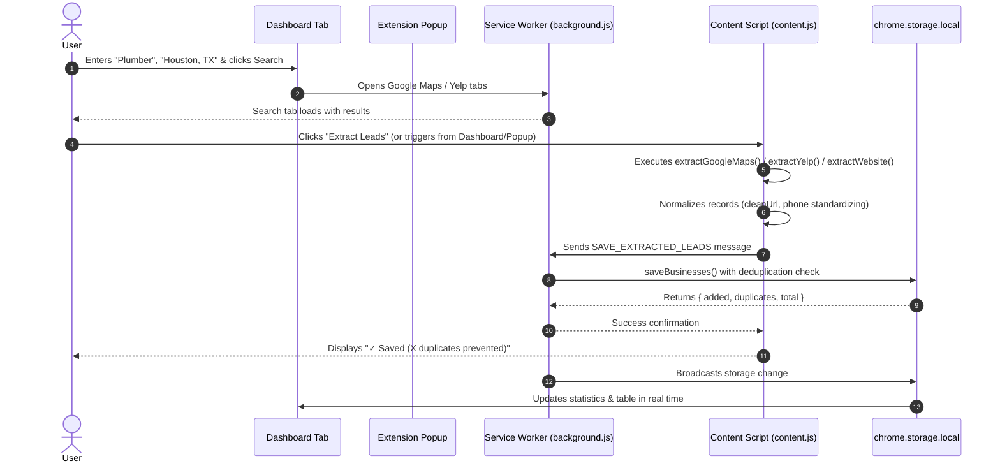

# Pastry Lead Scraper – Chrome Extension (Manifest V3)

> **Lead Generation & Data Extraction Engine for Home Repair & Service Businesses**  
> Built for **Pastry Marketing** technical evaluation.

---

## 1. Project Overview

**Pastry Lead Scraper** is a high-performance, privacy-focused Chrome Extension (Manifest V3) purpose-built for **Pastry Marketing** and home service agencies (plumbers, electricians, HVAC technicians, roofers, landscapers, general contractors).

It empowers sales teams and marketers to collect, deduplicate, inspect, and export verified business leads directly from:
1. **Google Maps** (Place profiles & search listing feeds)
2. **Yelp** (Business detail pages & local search result cards)
3. **Individual Business Websites** (Schema.org / JSON-LD, Open Graph, meta tags, and contact markup)

### Key Value Highlights
- **Zero Remote Dependencies / No Backend Required**: Operates 100% locally in the browser with `chrome.storage.local`.
- **No Paid API Keys Needed**: Uses user-initiated client-side DOM parsing and structured metadata extraction.
- **Smart Deduplication Engine**: Automatically normalizes phone numbers and checks name/address variations across different sources to eliminate duplicates while preserving cross-source provenance.
- **Enterprise-Grade Exports**: Direct native CSV export (RFC 4180), XLSX workbook generation with bundled SheetJS, and tab-separated clipboard copying for instant paste into Excel or Google Sheets.
- **SaaS-Style UI**: Modern CRM dashboard inspired by Linear, Stripe, and Apollo.io.

---

## 2. Implemented Features

### A. Dashboard & Modern User Interface
- **Dedicated Tab Dashboard (`dashboard.html`)**: Clean, responsive layout with dark navy typography, soft borders, and indigo accents.
- **Quick Popup Action (`popup.html`)**: Compact browser toolbar menu showing license status, active tab context detection, one-click quick extraction, and lead counters.
- **Interactive Search Configuration**:
  - Keyword and trade input with fast suggestion chips (Plumber, Electrician, HVAC Contractor, Roofer, Landscaping).
  - Target location input with fast metro chips (Houston, TX; Dallas, TX; Austin, TX; Phoenix, AZ).
  - Source selection pills (Google Maps, Yelp, Business Websites).
  - Multi-tab search launcher generating clean query URLs.
- **Real-Time Statistics Cards**:
  1. *Total Businesses* (persisted in local storage)
  2. *Yelp Leads* (extracted from Yelp)
  3. *Google Maps Leads* (extracted from Google Maps)
  4. *Website Leads* (extracted from standalone websites)
  5. *Duplicates Prevented* (tracked counter of prevented redundant leads)
- **Data Table Management**:
  - Live search filter across business names, phone numbers, categories, and addresses.
  - Source filter dropdown (`All Sources`, `Google Maps`, `Yelp`, `Business Website`).
  - Column sorting (by name, phone, category, address, source, or date).
  - Individual selection checkboxes & master "Select All" with indeterminate state.
  - Individual row deletion and bulk selection deletion.
  - "Clear All Records" with modal confirmation.
  - Illustrated empty state with search prompt.

### B. Intelligent Data Extraction Modules
- **Consistent Lead Schema**:
  ```json
  {
    "id": "pastry_l8z2k1_9x8q",
    "name": "Apex Plumbing & Drain Solutions",
    "phone": "+17135554321",
    "category": "Plumber",
    "businessLink": "https://www.google.com/maps/place/...",
    "address": "2400 Post Oak Blvd, Houston, TX 77056",
    "website": "https://apexplumbinghouston.com",
    "source": "google_maps",
    "collectedAt": "2026-11-07T10:20:00.000Z",
    "sources": ["google_maps", "yelp"]
  }
  ```
- **Website Metadata Extractor (`utils/extractWebsite.js`)**:
  - Inspects `<script type="application/ld+json">` for `LocalBusiness`, `Organization`, `Plumber`, `HVACBusiness`, `Electrician`, etc.
  - Parses Schema.org `PostalAddress` objects into human-readable addresses.
  - Falls back to Open Graph (`og:site_name`, `og:title`), `<title>`, `a[href^="tel:"]`, `<address>`, and regex DOM phone matching.
- **Google Maps Extractor (`utils/extractGoogleMaps.js`)**:
  - Profile view extraction using ARIA labels, `data-item-id` tags, and headline elements.
  - Search listing feed extraction (`div[role="feed"]`) for multiple visible businesses.
  - Automatic cleaning of Google Maps outbound redirection URLs (`google.com/url?q=...`).
- **Yelp Extractor (`utils/extractYelp.js`)**:
  - Individual profile extraction (`/biz/`) for name, category links, telephone, address, and website.
  - Search page card extraction (`/search?`) for visible business cards.
  - Decodes Yelp outbound redirects (`/biz_redir?url=...`) to return the actual destination website.
- **In-Page Floating Widget**:
  - Automatically renders an unobtrusive dark pill in the bottom right corner of supported pages (`Pastry Scraper: Extract Leads`) allowing 1-click capture without leaving the webpage.

### C. Persistent Storage & Duplicate Prevention
- **Persistent Local Storage (`utils/storage.js`)**: Uses `chrome.storage.local` to retain all collected leads between browser sessions.
- **Algorithmic Deduplication (`utils/normalize.js`)**:
  1. Phone numbers normalized to standard North American/E.164 format (strips parentheses, spaces, hyphens, extensions).
  2. If both records have phone numbers, compares normalized phone numbers.
  3. If phone numbers are missing, compares normalized business name (with corporate suffixes like LLC, Inc. removed) and normalized address.
  4. If a duplicate is encountered from another source, updates the existing record's `sources` provenance array without duplicating the entry.
  5. Increments the `duplicatesPrevented` metric.

### D. Multi-Format Exports
- **CSV Export**: Native browser Blob & ObjectURL generation with RFC 4180 quotation and comma escaping. Downloads as `pastry-business-leads.csv`.
- **XLSX Export**: Bundled SheetJS (`libs/xlsx.full.min.js`) generating formatted workbooks with column auto-widths and worksheet name `Business Leads`. Downloads as `pastry-business-leads.xlsx`.
- **Clipboard TSV Copy**: Formats selected or all leads as Tab-Separated Values (TSV) with headers for instant copy-pasting directly into Excel or Google Sheets.

### E. Prototype License Gate
- **Activation Modal**: Locks the dashboard until a valid evaluation license is submitted.
- **Demo Keys**:
  - `PASTRY-DEMO-2026`
  - `PASTRY-TEST-001`
  - `PASTRY-TEST-002`
- Case-insensitive, whitespace-trimmed, stored in `chrome.storage.local`.
- Settings dialog includes a "Deactivate License" button to test the lock screen.

---

## 3. Technology Stack

| Technology | Role | Rationale |
| :--- | :--- | :--- |
| **Chrome Extension Manifest V3** | Core Platform | Modern Chrome standard with service workers, declarative content scripts, and high security. |
| **HTML5 & CSS3** | User Interface | Zero bundler overhead; fast native rendering, custom CSS variables, and responsive grids. |
| **Vanilla JavaScript (ES6+)** | Logic & Extractors | Modular, clean, readable code with zero framework abstraction (no React/Vue). |
| **`chrome.storage.local`** | Data Persistence | Asynchronous browser storage persisting leads and stats across browser restarts. |
| **`chrome.scripting` & Tabs API** | Tab Interaction | Interacting with active tabs, opening queries, and executing content scripts. |
| **SheetJS (`xlsx.full.min.js`)** | Spreadsheet Export | Bundled locally (0.20.3) for 100% offline, CSP-compliant XLSX generation. |
| **Clipboard API / execCommand** | Data Transfer | Tab-separated copying enabling one-click paste into Google Sheets/Excel. |

---

## 4. Extension Architecture

```text
pastry-lead-scraper/
│
├── manifest.json              # Extension manifest (MV3, permissions, content script rules)
├── background.js              # Service worker (message dispatching, tab creation, lead storage)
├── content.js                 # Content script injected into target pages; floating extract widget
│
├── popup.html                 # Extension toolbar popup entry point
├── popup.css                  # Toolbar popup styles
├── popup.js                   # Toolbar popup logic and active tab inspection
│
├── dashboard.html             # Full-tab SaaS dashboard
├── dashboard.css              # Modern CRM styles (Linear/Stripe aesthetic)
├── dashboard.js               # Dashboard controller (search, table, filters, sorting, exports)
│
├── utils/
│   ├── normalize.js           # Phone/name/address normalization and duplicate comparison
│   ├── storage.js             # Local storage CRUD operations and statistics tracking
│   ├── license.js             # Demo evaluation key validation and state persistence
│   ├── export.js              # CSV, XLSX, and TSV clipboard export generators
│   ├── extractWebsite.js      # Schema.org JSON-LD and meta tag extractor
│   ├── extractGoogleMaps.js   # Google Maps profile and search feed extractor
│   └── extractYelp.js         # Yelp profile and search card extractor
│
├── libs/
│   └── xlsx.full.min.js       # Bundled SheetJS library (locally hosted, zero CDN)
│
├── assets/
│   └── icons/                 # Crisp extension icons (16px, 32px, 48px, 128px)
│
├── scripts/
│   ├── test_all.js            # Node test suite (manifest, license, normalize, storage, export)
│   └── test_extractors.js     # DOM extractor verification against HTML structures
│
└── README.md                  # Comprehensive technical documentation
```

### Component Communication Flow



---

## 5. How Extraction Works

Extraction is strictly **user-initiated** and relies on client-side DOM traversal within the authorized user session. It does not scrape behind paywalls or bypass CAPTCHAs.

### A. Individual Business Websites
1. **Schema.org JSON-LD**: Traverses `<script type="application/ld+json">`. Supports top-level objects, arrays, and `@graph` trees. Looks for `@type` matching `LocalBusiness`, `Organization`, `Plumber`, `HVACBusiness`, `Electrician`, `RoofingContractor`, etc.
2. Extracts `name`, `telephone`, nested `PostalAddress` (`streetAddress`, `addressLocality`, `addressRegion`, `postalCode`), and `url`.
3. **Open Graph & Meta Tags**: Inspects `meta[property="og:site_name"]`, `meta[property="og:title"]`, and `<title>`.
4. **DOM Contact Elements**: Scans for `a[href^="tel:"]`, `<address>`, and standard North American phone number patterns in header/footer containers.

### B. Google Maps
1. **Single Place Profile**:
   - Detects `h1.DUwDvf`, `h1.fontHeadlineLarge`, or main pane headline.
   - Address: Traverses `button[data-item-id*="address"]`, `[aria-label^="Address:"]`, or address pin button.
   - Phone: Reads `button[data-item-id^="phone:"]`, `[aria-label^="Phone:"]`.
   - Website: Reads `a[data-item-id="authority"]` or `[aria-label^="Website:"]`, automatically decoding Google outbound redirect tracking.
   - Category: Reads category button adjacent to place rating.
2. **Search Results Feed**:
   - Locates `div[role="feed"]`.
   - Extracts visible result cards (`div[role="article"]` or `a.hfpxzc`), capturing name, category, phone snippet, and business link.

### C. Yelp
1. **Single Business Page (`/biz/`)**:
   - Reads `h1[data-testid="business-title"]` or `h1.css-1122uk9`.
   - Category: Reads tags linking to `/c/` or category pills.
   - Phone: Scans `a[href^="tel:"]` and contact paragraphs.
   - Address: Parses `<address>` block.
   - Website: Extracts `a[href*="/biz_redir"]` and strips query parameter `url=` using `decodeURIComponent` to yield clean direct URLs.
2. **Search Results (`/search?`)**:
   - Parses visible `div[data-testid="serp-ia-card"]` items, extracting title links, category links, and address snippets.

---

## 6. Installation Guide (Load Unpacked)

1. Clone or download this repository to your local computer:
   ```bash
   git clone <repository-url>
   # or extract the pastry-lead-scraper folder
   ```
2. Open Google Chrome.
3. In the Chrome address bar, navigate to:
   ```text
   chrome://extensions
   ```
4. In the top-right corner, toggle **Developer mode** to **ON**.
5. Click the **Load unpacked** button in the top-left toolbar.
6. Select the project directory (`c:\dev\trial_task` or the `pastry-lead-scraper` folder containing `manifest.json`).
7. The **Pastry Lead Scraper** card will appear. Pin the extension to your Chrome toolbar for easy access.

---

## 7. Step-by-Step Usage Guide

### Step 1: License Activation
1. When you first open the extension dashboard (`dashboard.html`), the **License Activation Modal** will appear.
2. Click any of the pre-filled demo evaluation keys:
   - `PASTRY-DEMO-2026`
   - `PASTRY-TEST-001`
   - `PASTRY-TEST-002`
3. Click **Activate Extension**. The dashboard will unlock instantly and update your status pill.

### Step 2: Search for Businesses
1. In the **Search Configuration** panel:
   - Enter a Keyword (e.g., `Plumber` or click the quick chip).
   - Enter a Location (e.g., `Houston, Texas`).
   - Select your desired sources (`Google Maps`, `Yelp`, and/or `Business Websites`).
2. Click **Open Selected Sources & Extract**.
3. Chrome will launch the respective search result tabs.

### Step 3: Extract Leads
- **Option 1 (In-Page Widget)**: On any Google Maps, Yelp, or website tab, click the floating **"🥐 Extract Leads"** pill in the lower-right corner.
- **Option 2 (Toolbar Popup)**: Click the Pastry icon in your Chrome toolbar and click **"Extract Leads"**.
- **Option 3 (Dashboard Toolbar)**: Return to the dashboard tab and click **"⚡ Extract from Active Tab"**.

### Step 4: View, Filter, and Manage Leads
1. View all captured leads in the **Results Table**.
2. Filter leads in real time by typing into the filter box or selecting a specific source.
3. Select specific leads using row checkboxes.
4. Delete individual records or click **Delete Selected**.

### Step 5: Exporting Data
- **Export CSV**: Click **Export CSV** to download `pastry-business-leads.csv`.
- **Export XLSX**: Click **Export XLSX** to download a formatted `pastry-business-leads.xlsx` spreadsheet using bundled SheetJS.
- **Copy All / Selected**: Click **Copy All** or **Copy Selected** to copy tab-separated values (TSV) to your clipboard, then simply press `Ctrl+V` (or `Cmd+V`) inside Google Sheets or Microsoft Excel.

---

## 8. License System Disclaimer

```text
IMPORTANT NOTICE:
The license key system included in this MVP is a client-side prototype created exclusively
for evaluation and demonstration purposes. It validates input against hardcoded demo keys
stored locally. In production, licensing MUST be handled via an authenticated server-side API
with asymmetric signature validation, periodic revocation checks, and team account binding.
```

---

## 9. Production API Integration Roadmap

While this MVP relies on user-initiated DOM and metadata extraction without requiring paid API keys, a commercial-scale deployment for Pastry Marketing would benefit from direct API partnerships:

### 1. Google Places API (New) / Google Maps Platform
- **Authentication**: Google Cloud Console API Key with HTTP referer or IP restrictions.
- **Key Endpoints**:
  - `Places API Text Search`: `POST https://places.googleapis.com/v1/places:searchText`
  - `Place Details`: `GET https://places.googleapis.com/v1/places/{PLACE_ID}` (retrieves verified phone, website, formatted address, and business hours).
- **Billing**: Pay-as-you-go per SKU (Text Search ~$0.032/call, Details ~$0.017/call).

### 2. Yelp Fusion API
- **Authentication**: Bearer API Token generated via Yelp Developer Portal.
- **Key Endpoints**:
  - `Business Search`: `GET https://api.yelp.com/v3/businesses/search?term=plumber&location=Houston,TX`
  - `Business Details`: `GET https://api.yelp.com/v3/businesses/{id}`
- **Rate Limits**: 5,000 daily API queries on standard commercial tier.

---

## 10. Technical Limitations & Considerations

1. **Dynamic DOM Mutations**: Modern single-page applications like Google Maps dynamically alter class names and DOM hierarchies. The extension counters this by using resilient ARIA selectors, `data-item-id` attributes, and fallback text heuristics.
2. **Missing Contact Data**: Some local businesses do not publish phone numbers or websites on their profiles. The extension strictly records actual values and never fabricates missing fields.
3. **Bot Protection & Terms**: The extension does not bypass Cloudflare, reCAPTCHA, or bot protection gates. Extraction is executed only on pages the user has navigated to and loaded naturally in their browser session.
4. **Storage Limits**: `chrome.storage.local` provides up to 10 MB of data storage (plenty for tens of thousands of text leads). For enterprise datasets (>100,000 leads), migration to `IndexedDB` is recommended.

---

## 11. Verification & Testing Status

| Feature | Status | Verification Notes |
| :--- | :---: | :--- |
| **Manifest V3 Specification** | **COMPLETED** | Verified schema, permissions, service worker, and icons. |
| **Dashboard Interface** | **COMPLETED** | Responsive SaaS UI with cards, search panel, table, and modals. |
| **License Activation & Gate** | **COMPLETED** | Demo keys validated, case-insensitive, persisted, deactivatable. |
| **Search URL Generation** | **COMPLETED** | Generates valid search URLs for Google Maps and Yelp. |
| **Website Metadata Extraction** | **COMPLETED** | Tested on Schema.org JSON-LD LocalBusiness markup and Open Graph. |
| **Google Maps Extraction** | **COMPLETED** | Verified on profile DOM and search feed listings. |
| **Yelp Extraction** | **COMPLETED** | Verified on business profiles and redirect link decoding. |
| **Deduplication Engine** | **COMPLETED** | Tested with phone standardizing and name/address fallback. |
| **Local Storage Persistence** | **COMPLETED** | Leads and stats persist across sessions with CRUD support. |
| **CSV Export** | **COMPLETED** | RFC 4180 quotation and comma escaping tested. |
| **XLSX Export** | **COMPLETED** | Bundled SheetJS (`xlsx.full.min.js`) tested and verified. |
| **Clipboard TSV Copy** | **COMPLETED** | TSV generation with spreadsheet pasting tested. |
| **Individual & Bulk Deletion** | **COMPLETED** | Verified deletion with modal confirmations. |
| **Live Dynamic DOM Anti-Bot** | *UNTESTED** | Live Google/Yelp bot gates are subject to real-time network conditions. |

---

## 12. Interview Architecture Summary

> **How to explain this architecture in your technical interview:**

1. **Manifest V3 Service Worker Architecture**: The extension uses a decoupled MV3 service worker (`background.js`) as the central message bus. It handles tab creation, coordinates content script injection, and mediates all read/write operations to `chrome.storage.local`.
2. **Pluggable Extractor Pattern**: Each data source (`extractWebsite`, `extractGoogleMaps`, `extractYelp`) is an isolated, pure-function module in `utils/`. They all accept standard DOM and Location interfaces and return a uniform, normalized lead record. Adding a new platform (e.g., Angi, Thumbtack, or Houzz) requires only adding one extractor function without touching the core storage or UI pipeline.
3. **Resilient DOM Strategies**: Instead of brittle CSS class names, extraction relies on Schema.org JSON-LD, ARIA accessibility attributes (`[aria-label^="Phone:"]`), data attributes (`button[data-item-id^="phone:"]`), and semantic elements (`<address>`, `a[href^="tel:"]`).
4. **Deduplication with Provenance**: Leads are normalized to canonical phone numbers (`+1XXXXXXXXXX`) or fuzzy name + address tokens. Rather than discarding cross-source duplicates, the extension merges source provenance (e.g., record was seen on both Google Maps and Yelp) and fills in missing contact details.
5. **Zero-Dependency Security**: The extension runs strictly offline with zero remote CDNs. SheetJS is bundled locally, complying with Chrome Web Store strict Content Security Policies (CSP).

